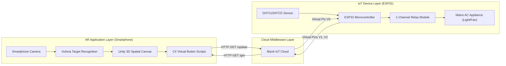
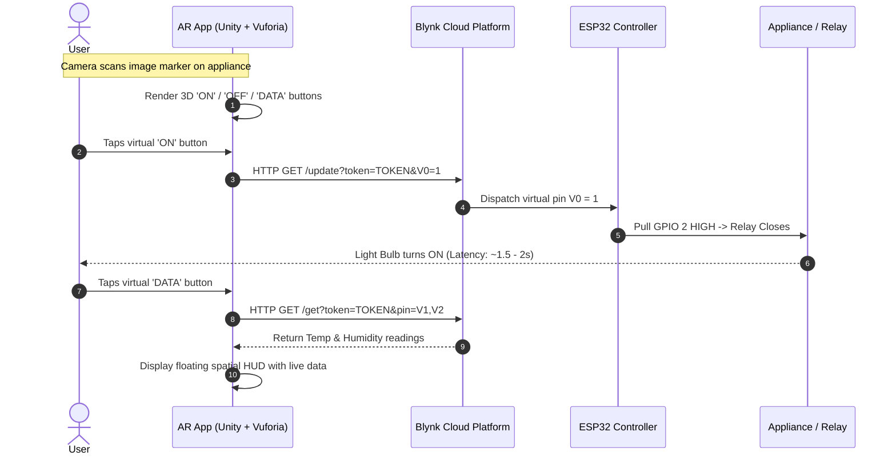

# 🌐 Augmented Reality–Enabled Internet of Things (AR-IoT): Virtual Appliance Control Interface

[](https://unity.com/)
[](https://developer.vuforia.com/)
[](https://www.espressif.com/)
[](https://www.arduino.cc/)
[](https://blynk.io/)
[](LICENSE)

> A context-aware cyber-physical interface combining Augmented Reality (AR) with the Internet of Things (IoT). Instead of navigating 2D mobile dashboards, users scan physical appliances to interact with spatial 3D control buttons and view real-time environmental telemetry directly anchored onto real-world devices.

---

## 📌 Table of Contents
- [Overview](#-overview)
- [System Architecture](#-system-architecture)
- [How It Works](#-how-it-works)
- [Comparative Study: AR-IoT vs. Traditional IoT](#-comparative-study-ar-iot-vs-traditional-iot)
- [Key Features](#-key-features)
- [Hardware & Circuit Connections](#-hardware--circuit-connections)
- [Software Stack & Tools](#-software-stack--tools)
- [Setup & Deployment Guide](#-setup--deployment-guide)
  - [1. ESP32 Firmware Setup](#1-esp32-firmware-setup)
  - [2. Blynk Cloud Configuration](#2-blynk-cloud-configuration)
  - [3. Unity AR Interface Configuration](#3-unity-ar-interface-configuration)
- [Repository Structure](#-repository-structure)
- [Academic Mentorship & Team](#-academic-mentorship--team)
- [License](#-license)

---

## 🔬 Overview

Traditional IoT implementations rely heavily on 2D mobile apps, web dashboards, or smart speakers. These solutions lack physical context awareness—requiring users to mentally map digital switches on a flat screen to physical appliances across rooms.

This project introduces a **three-tier AR-IoT cyber-physical architecture**:
1. **Augmented Reality Frontend**: Built using Unity and Vuforia Engine. Pointing a smartphone camera at an appliance reveals contextual 3D control buttons (`ON`, `OFF`) and floating telemetry widgets (`DATA`).
2. **Cloud Orchestration Layer**: Utilizes the Blynk IoT Cloud RESTful API as an event-driven middleware bridge.
3. **IoT Microcontroller Node**: Powered by an ESP32 microcontroller connected to environmental sensors (DHT11/DHT22) and an electromechanical relay module controlling mains AC loads (e.g., light bulbs, fans).

---

## 🏗️ System Architecture



### End-to-End Interaction Flow


---

## 📊 Comparative Study: AR-IoT vs. Traditional IoT

| Parameter | Traditional IoT Mobile Apps | Proposed AR-IoT System |
|:---|:---|:---|
| **Interface Format** | Flat 2D screen controls | Contextual 3D AR spatial overlay |
| **Cognitive Load** | High (must search appliance name in list) | Minimal (direct point-and-click in physical space) |
| **Environmental Context** | Abstract; detached from real world | High; spatially anchored to physical appliance |
| **Telemetry Display** | Plain numerical lists or graphs | Floating AR holographic readout adjacent to device |
| **Interaction Latency** | ~1.0 – 1.5 seconds | ~1.5 – 2.0 seconds (via Cloud REST API) |
| **Engagement** | Moderate / utilitarian | High immersion; aligns with Metaverse & Industry 4.0 |

---

## ✨ Key Features

- **Marker-Based Image Recognition**: High-contrast geometric targets detected in under 2 seconds using the Vuforia Engine.
- **Bi-directional Cyber-Physical Control**: Toggling virtual buttons executes hardware state changes in real time via an ESP32 and relay.
- **Real-Time Environmental HUD**: Spatial temperature and humidity telemetry readouts from DHT sensors pushed to the AR display.
- **Network Resilience**: Integrated `WiFiManager` with captive portal for dynamic wireless provisioning without hardcoding credentials into firmware.
- **Hardware Agnostic Mobile Deployment**: Runs on standard Android smartphones (Android 7.0+) without requiring expensive specialized AR glasses.

---

## 🔌 Hardware & Circuit Connections

| Component | Pin | ESP32 GPIO | Description |
|:---|:---:|:---:|:---|
| **DHT11 / DHT22** | DATA | `GPIO 13` | One-wire digital telemetry bus |
| **DHT11 / DHT22** | VCC / GND | `3V3` / `GND` | Sensor power supply |
| **1-Channel Relay** | IN | `GPIO 2` | Digital relay trigger signal (Active High) |
| **1-Channel Relay** | VCC / GND | `VIN (5V)` / `GND` | Relay coil power |
| **AC Load (Light Bulb)** | Live / Neutral | Relay `COM` & `NO` | Switched 230V AC mains connection |

> For complete schematics and terminal diagrams, refer to [`docs/hardware_connections.md`](docs/hardware_connections.md).

---

## 🛠️ Software Stack & Tools

- **Game Engine**: Unity 3D (v2021.3 LTS)
- **AR Framework**: Vuforia Engine SDK (v10.12+)
- **Microcontroller**: ESP32 NodeMCU
- **Firmware Development**: Arduino IDE / C++ (`WiFi.h`, `BlynkSimpleEsp32.h`, `WiFiManager.h`, `DHT.h`)
- **IoT Cloud**: Blynk IoT Cloud (Virtual Pins `V0`, `V1`, `V2`)
- **Deployment Platform**: Android OS (APK build)

---

## ⚙️ Setup & Deployment Guide

### 1. ESP32 Firmware Setup
1. Open the [Arduino IDE](https://www.arduino.cc/en/software).
2. Install the ESP32 board package via **Board Manager** (`https://raw.githubusercontent.com/espressif/arduino-esp32/gh-pages/package_esp32_index.json`).
3. Install required libraries from Library Manager:
   - `Blynk` by Volodymyr Shymanskyy
   - `WiFiManager` by tzapu
   - `DHT sensor library` by Adafruit
4. Open [`firmware/esp32_firmware/esp32_firmware.ino`](firmware/esp32_firmware/esp32_firmware.ino).
5. Update your `BLYNK_TEMPLATE_ID`, `BLYNK_TEMPLATE_NAME`, and `auth[]` token.
6. Connect your ESP32 via micro-USB and click **Upload**.

### 2. Blynk Cloud Configuration
1. Create a free account on [Blynk.cloud](https://blynk.cloud/).
2. Create a new Template with **ESP32** hardware and **WiFi** connection.
3. Configure the following **Datastreams**:
   - `V0`: Data type `Integer` (Min: 0, Max: 1) -> Appliance Relay Control
   - `V1`: Data type `Double` (Min: 0, Max: 100) -> Temperature (°C)
   - `V2`: Data type `Double` (Min: 0, Max: 100) -> Humidity (%)

### 3. Unity AR Interface Configuration
1. Open Unity Hub and create a 3D Project (Unity 2021.3 LTS).
2. Import the **Vuforia Engine** package from the Unity Package Manager.
3. Add an **AR Camera** and an **Image Target** to the scene.
4. Upload your target image to the [Vuforia Developer Portal](https://developer.vuforia.com/), download the Unity package database, and import it into your project.
5. Place a 3D Plane over the target and attach two UI Buttons (`ON`, `OFF`) and text displays for `Temperature` and `Humidity`.
6. Attach [`unity_scripts/ClickUrl.cs`](unity_scripts/ClickUrl.cs) to the `ON` and `OFF` buttons:
   - `ON` Button URL: `https://blynk.cloud/external/api/update?token=YOUR_TOKEN&V0=1`
   - `OFF` Button URL: `https://blynk.cloud/external/api/update?token=YOUR_TOKEN&V0=0`
7. Attach [`unity_scripts/FetchSensorData.cs`](unity_scripts/FetchSensorData.cs) to the `DATA` button and assign your TextMeshPro fields.
8. Go to **Build Settings** -> Select **Android** -> Click **Build and Run** to deploy the APK to your mobile phone.

---

## 📁 Repository Structure

```bash
ar-iot-appliance-control/
├── assets/
│   └── markers/                     # High-contrast target image markers for AR tracking
├── docs/
│   └── hardware_connections.md      # Pinout mapping and electrical wiring details
├── firmware/
│   └── esp32_firmware/
│       └── esp32_firmware.ino       # ESP32 firmware with WiFiManager & Blynk integration
├── unity_scripts/
│   ├── ClickUrl.cs                  # Unity C# script for dispatching HTTP GET actuation
│   └── FetchSensorData.cs           # Unity C# script for polling telemetry into spatial HUD
├── .gitignore                       # Clean Unity, Arduino, and OS ignore rules
├── LICENSE                          # MIT License
└── README.md                        # Project documentation and architectural overview
```

---

## 👥 Academic Mentorship & Team

- **Institution:** [Vallurupalli Nageswara Rao Vignana Jyothi Institute of Engineering & Technology (VNR VJIET)](https://vnrvjiet.ac.in/), Hyderabad, India
- **Department:** Computer Science & Engineering (Internet of Things)
- **Batch No:** 15
- **Student Contributors:**
  - **N Prasanna Lakshmi** (`22071A6945`)
  - **Chimata Sahithi** (`22071A6912`)
  - **N V Abhijeet Mukund** (`22071A6944`)
  - **U Ganesh Chowdary** (`22071A6961`)
  - **Sundala Dhanush** (`23075A6905`)
- **Faculty Guide:**
  - **Ms. Prathyusha**, Assistant Professor, Dept. of CSE - IoT, VNR VJIET

---

## 📄 License

This repository is distributed under the terms of the [MIT License](LICENSE).
